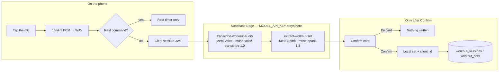

<p align="center">
  
</p>

<h1 align="center">Gymnos — In-Session Workout Copilot</h1>

<p align="center">
  Speak a set. Confirm it. Gymnos saves it once.<br />
  Meta Voice transcribes. Meta Spark extracts. You stay in control.
</p>

<p align="center">
  <a href="https://github.com/kayas881/gym-app/tree/hackathon/gymnos-in-session-copilot"></a>
  
  
  
  
</p>

---

## For judges — start here

This repository is a **live gym-management product** that already served a real gym in India. The hackathon submission is the **in-session workout copilot** added on top of that product.

| | |
|---|---|
| **Review this branch** | [`hackathon/gymnos-in-session-copilot`](https://github.com/kayas881/gym-app/tree/hackathon/gymnos-in-session-copilot) |
| **Pre-existing baseline** | [`main`](https://github.com/kayas881/gym-app/tree/main) @ `8b00c9a` |
| **Hackathon commit** | [`b5488e2`](https://github.com/kayas881/gym-app/commit/b5488e2) — *feat: add Gymnos in-session workout copilot* |
| **Diff vs baseline** | [`main...hackathon/gymnos-in-session-copilot`](https://github.com/kayas881/gym-app/compare/main...hackathon/gymnos-in-session-copilot) — **71 files, +14,158 / −7** |

```bash
git fetch origin
git checkout hackathon/gymnos-in-session-copilot
git log --oneline main..HEAD
git diff --stat main...HEAD
```

**Submit this URL**, so the landing page is the hackathon branch and not `main`:

`https://github.com/kayas881/gym-app/tree/hackathon/gymnos-in-session-copilot`

---

## What this copilot does

A member on the gym floor taps the mic and says something like:

> “Bench press, eighty kilos, eight reps, two RIR.”

Gymnos records 16 kHz PCM on the phone, encodes a WAV, sends it to **Meta Voice**, then sends the transcript to **Meta Spark**. A confirm card appears. **Discard leaves the database untouched.** Confirm keeps the set on the phone first, then syncs it to Supabase with a unique `client_id` so a retry on flaky gym wifi cannot insert the same set twice.

After that, the rest of the session is deterministic: rest timer, last-time numbers, personal records, and a next-session coach. Those layers read saved sets. They do not call a model.

---

## How a set is logged



1. **Speak.** `expo-audio` streams int16 PCM at 16 kHz. The phone builds a WAV (`lib/wav.ts`). Clips that are too short never leave the device.
2. **Understand.** Rest phrases (“skip rest”, “add 30 seconds”) are parsed locally in `lib/rest-period.ts`. Everything else goes to Meta Voice, then Meta Spark.
3. **Confirm.** `WorkoutSetConfirmCard` shows exercise, kg, reps, RIR, and uncertain fields. The member can edit before saving.
4. **Save once.** One session per IST calendar day (`UNIQUE (profile_id, started_on)`). Each set carries a phone-minted `client_id` (`UNIQUE`).

The Edge functions **never write a workout row**. Extraction returns a draft. Persistence happens in the client after the tap.

---

## Meta model pipeline

Two Meta models, two jobs, one secret.

| Step | Model | Where | Contract |
|---|---|---|---|
| Speech → text | **muse-voice-transcribe-1.0** | `supabase/functions/transcribe-workout-audio` | Multipart WAV, `mode: PUSH_TO_TALK`, gym-floor keyword bias |
| Text → set | **muse-spark-1.3** | `supabase/functions/extract-workout-set` | Strict `json_schema` named `WorkoutSet` |

`MODEL_API_KEY` is an Edge Function secret. The client is forbidden from sending `apiKey`, `model`, `prompt`, `schema`, or `messages` (`FORBIDDEN_CLIENT_KEYS` in `supabase/functions/_shared/workout_set.ts`).

### Spark extraction rules

The system prompt is intentionally conservative:

- Return `null` and list the field in `uncertainFields` when the transcript is missing or ambiguous.
- Accept kilograms only. Spoken “pounds” or a bare number do not become `weightKg`.
- Do not treat RIR as the set’s rep count. “razor” is not RIR.
- `needsConfirmation` is always `true` for this milestone.

Schema bounds match the database checks: weight 0–500 kg, reps 1–100, RIR 0–10.

### Auth on the functions

Clerk is wired into Supabase as a **third-party auth provider**, so `auth.uid()` is always `NULL`. Each function verifies the Bearer token itself (`supabase/functions/_shared/clerk_auth.ts`):

- RS256 only (`alg=none` / HMAC rejected)
- signature against the instance JWKS
- `exp` / `nbf` with a 5s clock skew
- issuer derived from `CLERK_PUBLISHABLE_KEY`
- JWKS cached 10 minutes, refreshed once on an unknown `kid`

RLS on the new tables uses `public.get_clerk_id()` / `public.get_current_profile_id()`.

---

## Built during this hackathon

Everything below is new on this branch. None of it exists on `main`.

### 1. Voice push-to-talk
Tap-to-stop recording, on-device WAV, confirm card, discard, pending-set cache for offline gym wifi.

- `hooks/usePushToTalkWorkout.ts`
- `app/(member)/session.tsx`
- `components/WorkoutSetConfirmCard.tsx`
- `lib/wav.ts`, `lib/transcribe-workout-audio.ts`, `lib/extract-workout-set.ts`

### 2. Persistent sessions
One IST day → one session. Confirm-then-persist. Idempotent `client_id`.

- `supabase/migrations/039_workout_sessions.sql`
- `lib/workout-session.ts`
- `app/(member)/sessions/index.tsx`, `app/(member)/sessions/[sessionId].tsx`

### 3. Rest-period intelligence
Suggested rest by lift category. Remaining time is `endsAt − now`, so backgrounding the app does not reset the clock. The same set cannot start a second timer. Voice can skip / pause / add time without another model call.

- `lib/rest-period.ts`, `lib/rest-prefs.ts`
- `hooks/useRestTimer.ts`
- `components/RestTimerCard.tsx`

### 4. Progress and personal records
Deterministic. Numbers come only from saved sets. Epley e1RM is `weight × (1 + reps / 30)`. Volume is kg·reps. The first session is a baseline, not a PR announcement.

- `lib/workout-progress.ts`
- `hooks/useWorkoutProgress.ts`
- `app/(member)/progress/index.tsx`, `app/(member)/progress/[exerciseKey].tsx`
- `components/ProgressLineChart.tsx`, `components/MuscleDistribution.tsx`, `components/SessionSummaryCard.tsx`

### 5. Workout plans and routine builder
Routines are a plan. Sessions are the log. Deleting a routine `SET NULL`s the plan snapshot and **never deletes workout history**. Starting a day copies a snapshot onto today’s session so later edits cannot rewrite what you already did.

- `supabase/migrations/040_workout_routines.sql`
- `lib/workout-routines.ts`, `lib/workout-plan.ts`, `lib/exercise-library.ts`
- `app/(member)/workouts/*`
- `components/ExercisePicker.tsx`

### 6. Adaptive coach
Double-progression suggestions from planned targets + confirmed history. Accept / Edit / Ignore apply only to the session snapshot. The coach never writes a routine row and never invents a missing RIR.

- `lib/workout-coach.ts`
- `components/ExerciseCoachCard.tsx`
- `app/(member)/workouts/active.tsx`

### New screens (member)

| Route | Role |
|---|---|
| `/(member)/session` | Free-form voice log |
| `/(member)/workouts` | Routines, start today’s day |
| `/(member)/workouts/edit` | Builder (days, targets, library) |
| `/(member)/workouts/active` | Planned session + coach + PTT |
| `/(member)/workouts/schedule` | Week view |
| `/(member)/workouts/library` | Exercise library |
| `/(member)/progress` | PRs, volume, muscle mix |
| `/(member)/progress/[exerciseKey]` | Per-lift history |
| `/(member)/sessions` | Past sessions |

Tabs added on this branch: **Workouts** and **Progress**. Session / active / edit routes stay off the tab bar (`href: null`) and are reached from those tabs and from Home.

---

## Already in the product (pre-hackathon)

`main` is Gymnos the gym-ops app. Owner, staff, and member each have their own Expo Router group.

- Memberships, plans, part-payments, outstanding dues
- Owner-created members who never install the app (`clerk_id` nullable)
- Claim codes that attach a later login to that existing record
- QR check-in, announcements, complaints, staff chat, receipts
- Clerk identity → Supabase third-party auth
- IST date handling throughout (`utils/date.ts`)

The copilot reuses that auth, that profile model, and that date layer. It does not replace the gym-ops product.

---

## Stack

| Layer | Choice |
|---|---|
| App | Expo SDK 57, React Native 0.86.3, React 19, Expo Router |
| Identity | Clerk (`@clerk/expo`) as a third-party provider into Supabase |
| Data | Hosted Supabase (Postgres + RLS). New tables in migrations **039** and **040** |
| Voice / extract | Supabase Edge Functions → Meta Voice + Meta Spark |
| Audio | `expo-audio` stream, PCM int16 16 kHz, WAV encoded on device |
| Dates | Asia/Kolkata. Storage is ISO `YYYY-MM-DD`. Display is `DD/MM/YYYY` |

---

## Data model (hackathon tables)

```
profiles
   └── workout_sessions          UNIQUE (profile_id, started_on)   IST day
          ├── workout_sets       UNIQUE (client_id)
          └── plan snapshot      copied from a routine day

workout_routines
   └── workout_routine_days
          └── workout_routine_exercises

Deleting a routine never deletes sessions or sets.
```

See the “why” comments at the top of:

- [`supabase/migrations/039_workout_sessions.sql`](supabase/migrations/039_workout_sessions.sql)
- [`supabase/migrations/040_workout_routines.sql`](supabase/migrations/040_workout_routines.sql)

---

## Engineering constraints we designed around

These are the decisions that took the most care. Each one exists because a quieter alternative failed in production or on the gym floor.

| Constraint | What we did |
|---|---|
| Gym wifi drops mid-save | Confirm writes locally first. `client_id` makes the retry the same row. |
| `auth.uid()` is always NULL | RLS and Edge auth use Clerk `sub` via `get_clerk_id()`. |
| IST vs UTC | Session day is `(now() AT TIME ZONE 'Asia/Kolkata')::date`. The app uses `utils/date.ts` / `useToday()`. |
| Model must not invent lifts | Spark returns `null` + `uncertainFields`. Confirm is mandatory. |
| Voice rest vs voice set | Rest intents are parsed on device and never billed as extraction. |
| Deleting a plan | `ON DELETE SET NULL` / cascade on plan metadata only. History stays. |
| PRs and coaching | Pure functions over saved sets. No model in the stats path. |
| Secret key | `MODEL_API_KEY` lives only in Edge secrets. Client payload is a transcript or a WAV. |

---

## Tests

Node’s built-in test runner. No extra test framework.

```bash
node --experimental-strip-types --test scripts/wav_test.ts
node --experimental-strip-types --test scripts/workout_set_client_test.ts
node --experimental-strip-types --test scripts/workout_session_test.ts
node --experimental-strip-types --test scripts/workout_progress_test.ts
node --experimental-strip-types --test scripts/workout_summary_test.ts
node --experimental-strip-types --test scripts/rest_period_test.ts
node --experimental-strip-types --test scripts/workout_plan_test.ts
node --experimental-strip-types --test scripts/workout_coach_test.ts
node --experimental-strip-types --test supabase/functions/_shared/clerk_auth_test.ts
node --experimental-strip-types --test supabase/functions/extract-workout-set/handler_test.ts
node --experimental-strip-types --test supabase/functions/transcribe-workout-audio/handler_test.ts
```

Live Meta smoke tests (need `MODEL_API_KEY` in your own env, never committed):

- `scripts/meta_voice_smoke_test.py`
- `scripts/meta_extraction_smoke_test.py`
- `scripts/extract_workout_set_e2e.ts`

---

## Run it locally

You need Node 20+, the Expo CLI, a Clerk application, a Supabase project, and a Meta model API key for the two Edge functions.

```bash
git clone https://github.com/kayas881/gym-app.git
cd gym-app
git checkout hackathon/gymnos-in-session-copilot
npm install
npx expo start --dev-client
```

Create a local `.env` (this file is gitignored):

```
EXPO_PUBLIC_CLERK_PUBLISHABLE_KEY=pk_test_...
CLERK_SECRET_KEY=sk_test_...          # Edge Function secret only
MODEL_API_KEY=...                     # Edge Function secret only
```

Then set the same two secrets on the Edge functions:

```
supabase secrets set CLERK_SECRET_KEY=... MODEL_API_KEY=...
```

JS-only changes load through Metro. A new native dependency needs an EAS `development` or `preview` build (`com.kayas.mygymapp`). This machine cannot produce a local Gradle APK.

---

## Repo map

```
app/(member)/session.tsx             Voice log screen
app/(member)/workouts/               Plans, editor, active session
app/(member)/progress/               PRs and per-lift history
app/(member)/sessions/               Past sessions
hooks/usePushToTalkWorkout.ts        Record → WAV → Meta → confirm → persist
lib/workout-*.ts                     Session, progress, plan, coach, rest
supabase/functions/transcribe-workout-audio/
supabase/functions/extract-workout-set/
supabase/functions/_shared/          Clerk JWKS auth, Spark schema, Voice multipart
supabase/migrations/039_*.sql        Sessions + sets
supabase/migrations/040_*.sql        Routines + plan snapshot
scripts/*_test.ts                    Deterministic unit tests
```

Pre-hackathon gym-ops code lives under `app/(owner)`, `app/(staff)`, `app/(auth)`, and the older member screens (home, attendance, payments, announcements).

---

## What we left out on purpose

- The model never writes PRs, dues, or attendance.
- There is no staff-side check-in for workouts. The owner does not keep a paper register today, and we did not invent one.
- Managed members (no app login) cannot use the mic. Their attendance already shows “not tracked”; we did not fake a zero.
- SAM 3.1 / on-device vision is not in this submission.

---

Built for the Meta hackathon by [kayas881](https://github.com/kayas881).
