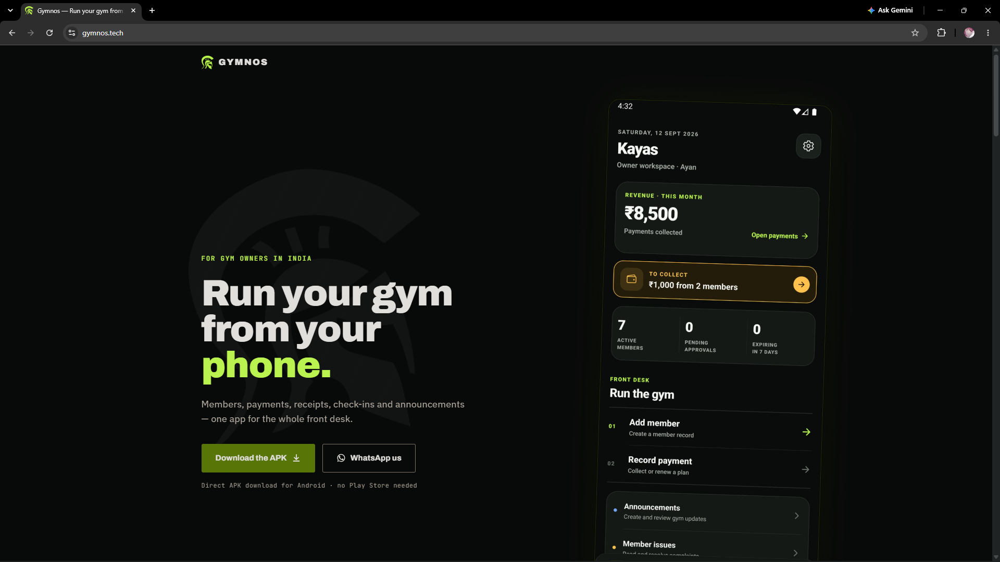
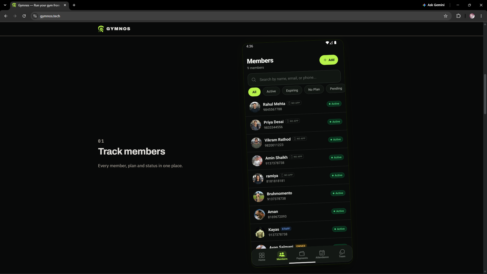
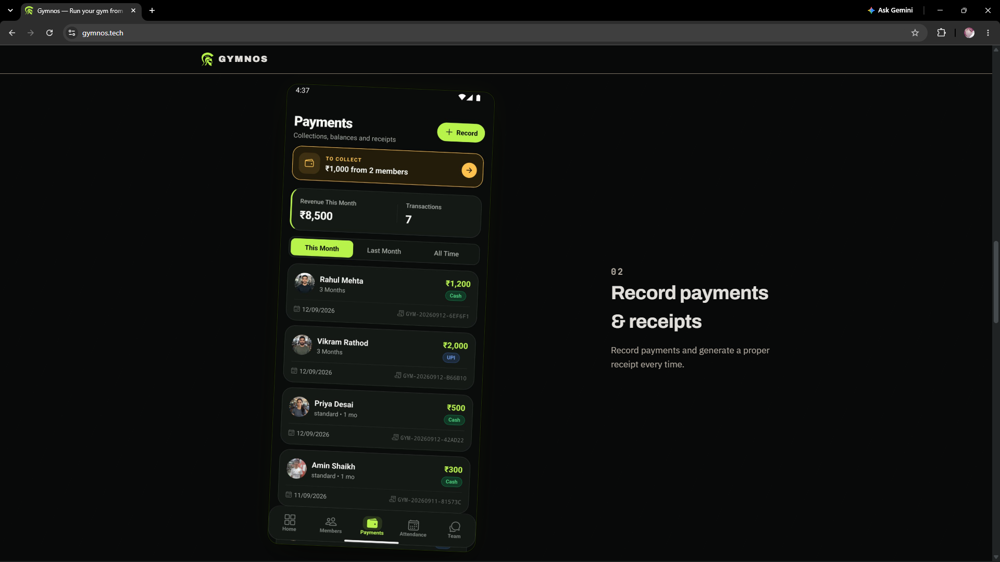
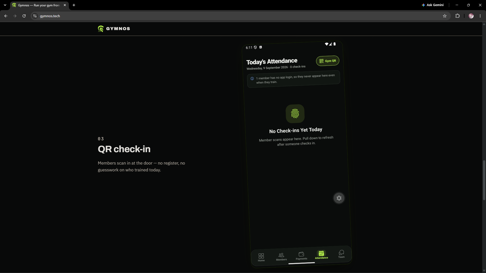
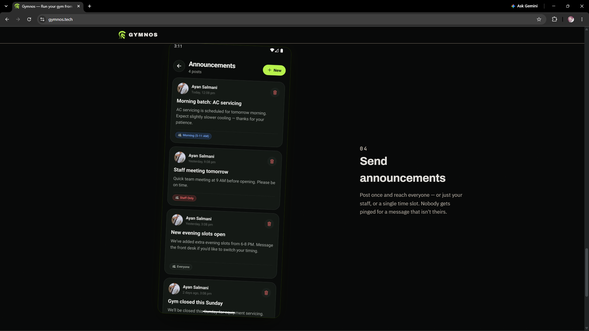

# Gymnos

**Site:** [gymnos.tech](https://gymnos.tech)  
**Demo:** [YouTube short](https://www.youtube.com/shorts/v1MzwtwfV60)

Gymnos is a gym-ops app for a small Indian gym that was running memberships off handwritten receipts. The owner needed to know who was a member, when they expired, and who still owed fees. Members needed a place to check their own status, pay, get announcements, and raise complaints — without a Play Store listing in the way.

Android builds go out as an APK from the site / GitHub Releases.



## Who uses it

| Role | What they do |
| --- | --- |
| Owner | Members, plans, dues, QR desk, announcements, receipts |
| Staff | Check-in, invites, announcements, staff chat |
| Member | Status, payments, attendance, complaints, workouts |

Owner-created members can exist before they ever install the app. A claim code attaches a later login to that record.

## What’s in the product

- Memberships, plans, part-payments, outstanding dues
- Cash / UPI payment log and printable receipts
- QR check-in and a live front-desk attendance count
- Announcements aimed at morning or evening batches (so a night blast doesn’t wake the 6am crowd)
- Complaints, staff chat, push notifications
- IST dates end-to-end (`utils/date.ts`)

<p>
  
  
</p>
<p>
  
  
</p>

## Voice workout copilot

On [`hackathon/gymnos-in-session-copilot`](https://github.com/kayas881/gym-app/tree/hackathon/gymnos-in-session-copilot) there is an in-session layer built for the Meta Global AI Developer Hackathon (26 Oct–4 Nov 2026).

A member says something like “bench press, eighty kilos, eight reps, two RIR.” Meta Muse Voice transcribes it. Muse Spark extracts the set. A confirm card is the only thing that writes. Rest timer, PRs, and progression then run on saved rows, not on another model call.

That work is documented on the branch. `main` here is the gym-ops app.

## Stack

Expo SDK 57 · React Native · Expo Router · TypeScript  
Clerk for identity (third-party into Supabase)  
Supabase (Postgres, RLS, Storage, Edge Functions)  
EAS + GitHub Releases for the APK

Landing site is a separate repo: [kayas881/Gymnos-Landing-page](https://github.com/kayas881/Gymnos-Landing-page).

## Repo layout

```
app/(owner)    owner screens
app/(staff)    staff screens
app/(member)   member screens
app/(auth)     sign-in / gym setup
components/
hooks/
lib/           Clerk + Supabase clients
supabase/      migrations and Edge Functions
```

## Run locally

You need Node, Expo, a Clerk app, and a Supabase project. Copy whatever env files this repo already uses locally — do not commit secrets.

```bash
npm install
npx expo start
```

Then `npm run android` for a device/emulator, or scan the QR from Expo Go / a dev client.

## License

See [LICENSE](LICENSE).
